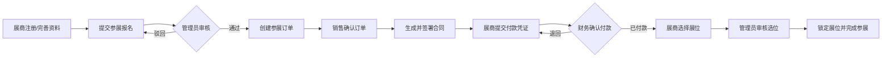
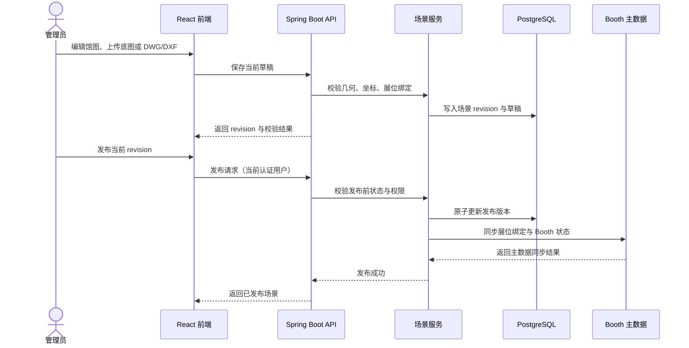
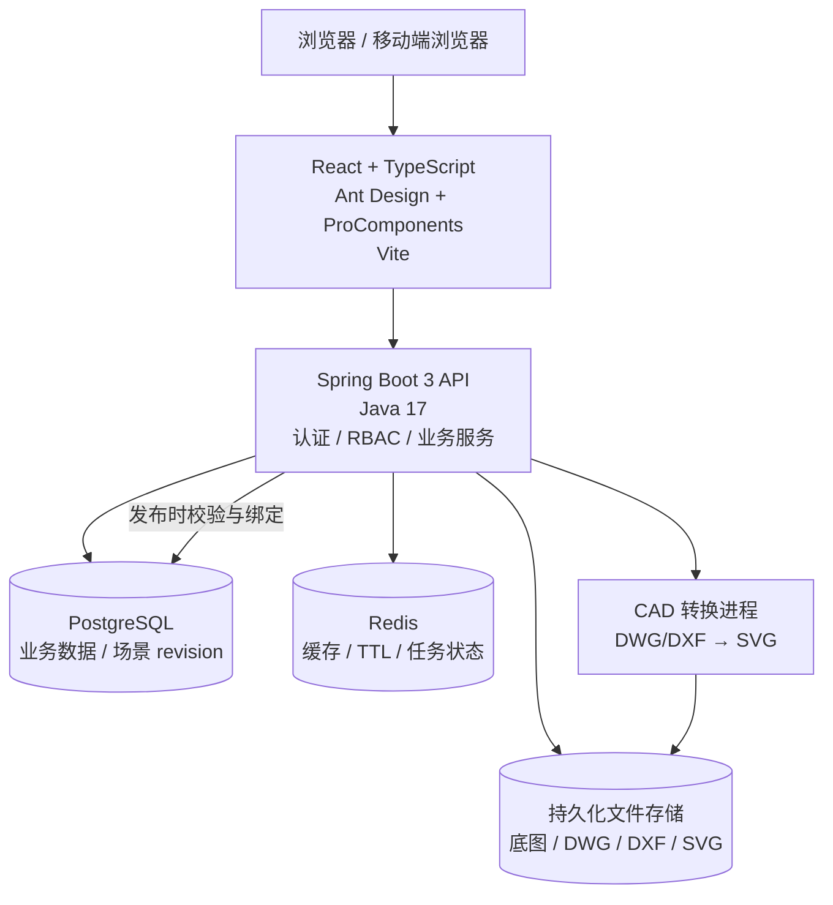
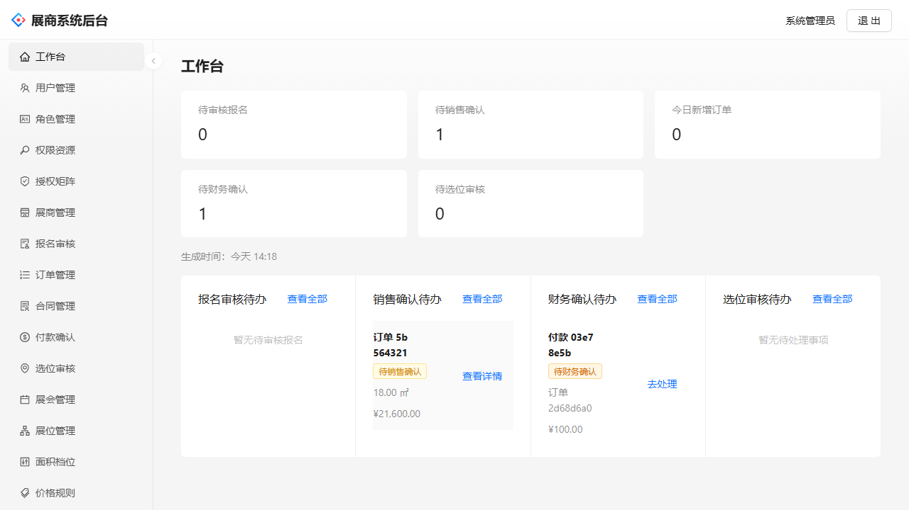
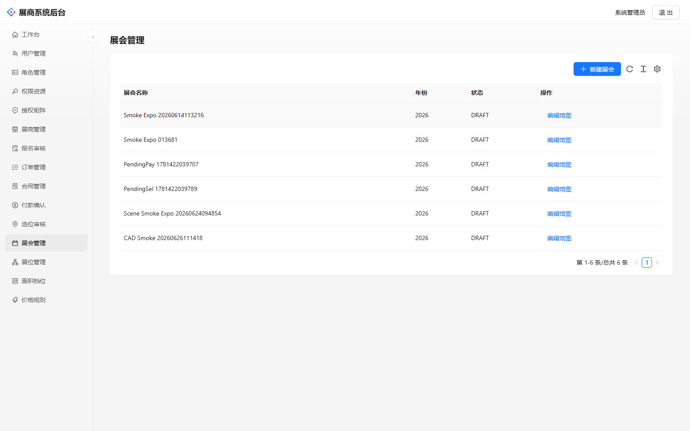
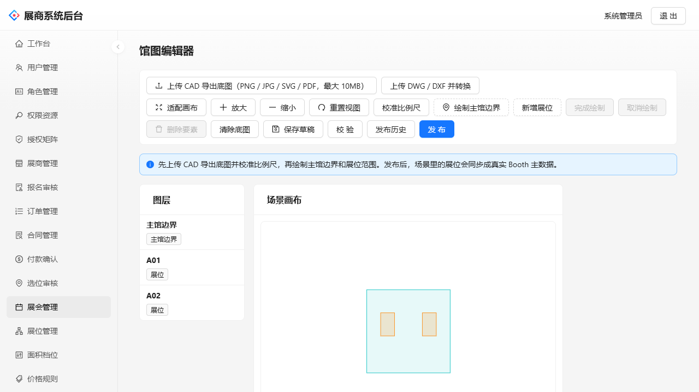
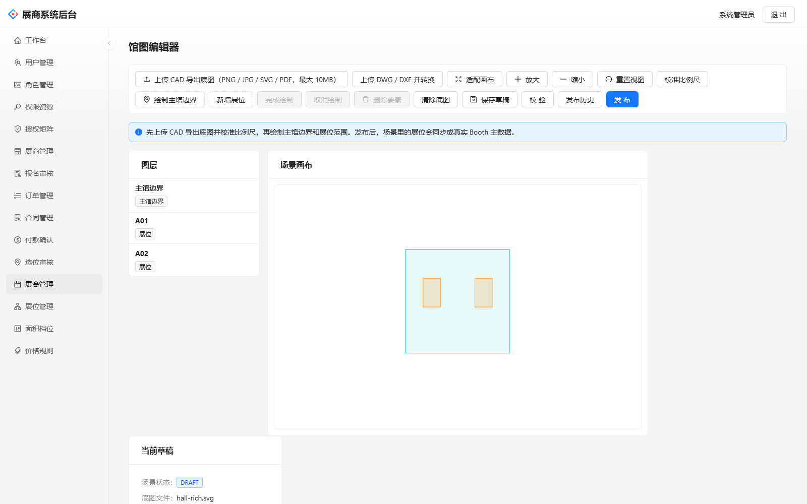
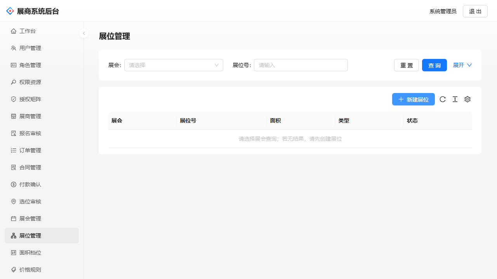
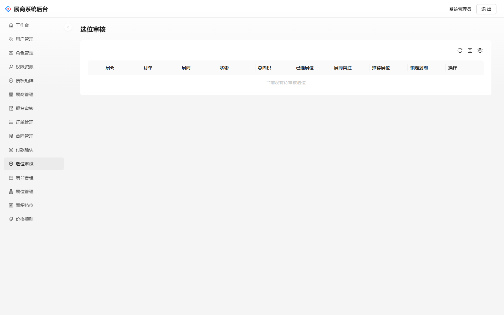

# 中国国际体育用品博览会展商业务系统

面向体育用品博览会主办方、销售、财务、客服和展商的全流程业务系统。系统覆盖展商报名、订单、合同、付款、展位选位、馆图场景编辑、CAD 转换和基于 RBAC 的权限管理。

## 项目亮点

- **展商业务闭环**：报名审核 → 订单确认 → 合同签署 → 付款确认 → 展位选位 → 管理员审核。
- **管理工作台**：集中处理展会、展商、订单、合同、付款、选位和审核待办。
- **场景编辑器**：支持馆图底图上传、比例尺校准、馆边界与展位绘制、草稿保存、历史版本只读预览和发布。
- **CAD 工作流**：支持 DWG/DXF 上传、格式与内容校验、异步转换为 SVG、失败状态提示和失败文件清理。
- **RBAC 权限体系**：用户、角色、权限资源、角色授权矩阵和数据范围控制。
- **生产部署准备**：提供 Docker Compose 本地基础设施和 Render Blueprint 部署配置。

## 角色与工作台

| 角色 | 主要能力 | 默认入口 |
| --- | --- | --- |
| 管理员 | 全量配置、权限管理、场景发布、选位审核 | `/admin/dashboard` |
| 组织方 | 展会、展位和场景运营 | `/admin/dashboard` |
| 销售 | 展商、报名、订单和合同处理 | `/admin/dashboard` |
| 财务 | 付款审核和财务状态跟进 | `/admin/dashboard` |
| 客服 | 展商服务、报名和选位协助 | `/admin/dashboard` |
| 展商 | 企业资料、报名、订单、付款和选位 | `/exhibitor` |

## 业务流程图



## 场景发布时序图



## 技术架构图



## 页面截图

以下图片来自当前前端开发服务器连接本地后端和 PostgreSQL 后的真实页面，包含管理员工作台、展会配置、馆图编辑和展位审核等功能。

| 页面 | 截图 |
| --- | --- |
| 管理员工作台 |  |
| 展会管理 |  |
| 馆图编辑器（含馆图要素与展位） |  |
| 馆图编辑器宽屏视图 |  |
| 展位管理 |  |
| 选位审核 |  |

登录页和权限提示页也保留在截图目录中，便于查看认证与权限边界：

- [登录页截图](docs/screenshots/login.png)
- [未登录提示页截图](docs/screenshots/unauthorized.png)
- [无权限提示页截图](docs/screenshots/forbidden.png)

启动完整环境后，可访问以下页面查看管理员工作台、场景编辑器和展商选位页面：

- 管理员工作台：`http://localhost:5173/admin/dashboard`
- 场景编辑器：`http://localhost:5173/admin/events/{eventId}/scene`
- 展商选位：`http://localhost:5173/exhibitor/orders/{orderId}/selection`

## 技术栈

- 前端：React 18、TypeScript、React Router、Ant Design、ProComponents、Vite
- 后端：Java 17、Spring Boot 3、Spring Security、Maven
- 数据库：PostgreSQL
- 缓存与任务状态：Redis
- 文件与 CAD：持久化文件存储、DWG/DXF 转换为 SVG
- 部署：Docker、Render Blueprint

## 本地启动

### 1. 启动 PostgreSQL 与 Redis

```bash
docker compose up -d
```

默认服务端口：PostgreSQL `5432`，Redis `6379`。

### 2. 启动后端

```bash
cd backend
mvn spring-boot:run
```

默认 API 地址：`http://localhost:8080`。

后端会使用 `APP_DB_SCHEMA` 指定的数据库 schema。连接共享 PostgreSQL 时，可配置：

```bash
SPRING_DATASOURCE_URL=jdbc:postgresql://host:5432/database
SPRING_DATASOURCE_USERNAME=username
SPRING_DATASOURCE_PASSWORD=password
APP_DB_SCHEMA=exhibitor_sys
```

### 3. 启动前端

```bash
cd frontend
npm install
npm run dev
```

默认前端地址：`http://localhost:5173`。

## 常用页面路由

### 展商端

- `/exhibitor`：展商工作台
- `/exhibitor/profile`：企业资料
- `/exhibitor/registrations`：报名列表
- `/exhibitor/registrations/new`：创建报名
- `/exhibitor/orders`：我的订单
- `/exhibitor/orders/new`：创建参展订单
- `/exhibitor/orders/{orderId}/payment`：提交付款
- `/exhibitor/orders/{orderId}/selection`：选择展位
- `/exhibitor/notifications`：通知中心

### 管理端

- `/admin/dashboard`：管理员工作台
- `/admin/users`：用户管理
- `/admin/roles`：角色管理
- `/admin/permissions`：权限资源
- `/admin/role-permissions`：角色授权矩阵
- `/admin/events`：展会管理
- `/admin/events/{eventId}/scene`：馆图场景编辑器
- `/admin/booths`：展位管理
- `/admin/orders`：订单审核
- `/admin/contracts`：合同管理
- `/admin/payments`：付款确认
- `/admin/selections`：选位审核

## 演示账号

所有演示账号密码均为 `demo123`：

| 账号 | 角色 | 默认入口 |
| --- | --- | --- |
| `admin` | 管理员 | `/admin/dashboard` |
| `organizer` | 组织方 | `/admin/dashboard` |
| `sales01` | 销售 | `/admin/dashboard` |
| `finance01` | 财务 | `/admin/dashboard` |
| `service01` | 客服 | `/admin/dashboard` |
| `exhibitor01` | 展商 | `/exhibitor` |

生产环境请立即替换演示密码，并通过环境变量或密钥管理服务配置数据库、Redis、文件存储和 JWT 等敏感信息。

## 验证命令

后端编译：

```bash
cd backend
mvn package -DskipTests
```

后端测试（需要可用的 PostgreSQL；无外部数据源时会尝试使用 Testcontainers）：

```bash
cd backend
mvn test
```

前端测试与生产构建：

```bash
cd frontend
npm test -- --run
npm run build
```

建议在发布前补充以下 smoke 流程：

1. 使用管理员上传 CAD，验证 DWG/DXF 格式、大小、MIME、空文件和内容校验。
2. 验证 CAD 转换成功、失败提示以及失败文件清理。
3. 保存场景草稿、校准比例尺、预览历史版本，再发布当前草稿。
4. 验证非法 Polygon、馆边界、坐标和展位状态变更会被拒绝。
5. 使用不同角色验证页面权限与事件数据范围。
6. 验证上传资源 URL 可访问，同时生产文件存储配置保持持久化。

## Render 部署

仓库包含 `render.yaml`，用于创建以下服务：

- `sport-expo-exhibitor-web`：React 静态站点
- `sport-expo-exhibitor-api`：容器化 Spring Boot API
- `sport-expo-exhibitor-db`：Render PostgreSQL
- `sport-expo-exhibitor-cache`：Render Key Value

部署步骤：

1. 将仓库推送到 GitHub。
2. 在 Render 中选择 **New → Blueprint**。
3. 选择本仓库并保留 Blueprint 文件路径 `render.yaml`。
4. 创建并部署服务。
5. 根据实际生成的服务 URL 更新 `VITE_API_BASE_URL` 与 `APP_CORS_ALLOWED_ORIGINS`。

Render 免费实例可能在一段时间无访问后休眠，首次访问需要等待服务重新启动。

## 项目目录

```text
backend/                 Spring Boot 后端与数据库迁移
frontend/                React 前端、页面与场景编辑器
docs/                    正式设计文档与页面截图
docker-compose.yml       本地 PostgreSQL / Redis
render.yaml              Render Blueprint 部署配置
```

## 相关文档

- [业务流程说明](中国国际体育用品博览会展商系统业务流程.md)
- [场景编辑器设计](docs/superpowers/specs/2026-06-23-venue-scene-editor-design.md)
- [认证与销售服务中心设计](docs/superpowers/specs/2026-06-20-auth-sales-service-center-design.md)

## 仓库清理约定

`.gitignore` 已忽略 `output/`、`tmp/`、`tmp-smoke/`、`.playwright-cli/`、`backend/tmp/`、构建目录、日志和一次性演示文件，避免生成物再次进入版本库。正式源码、测试、锁文件和设计文档会保留。
