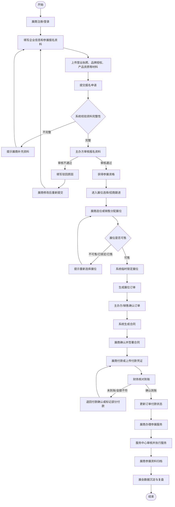
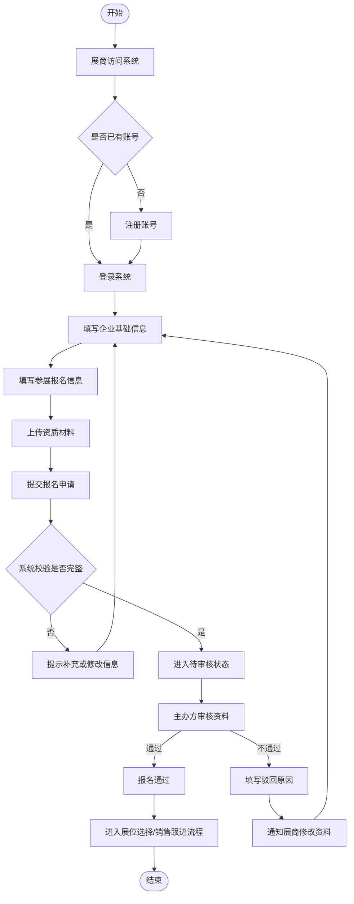
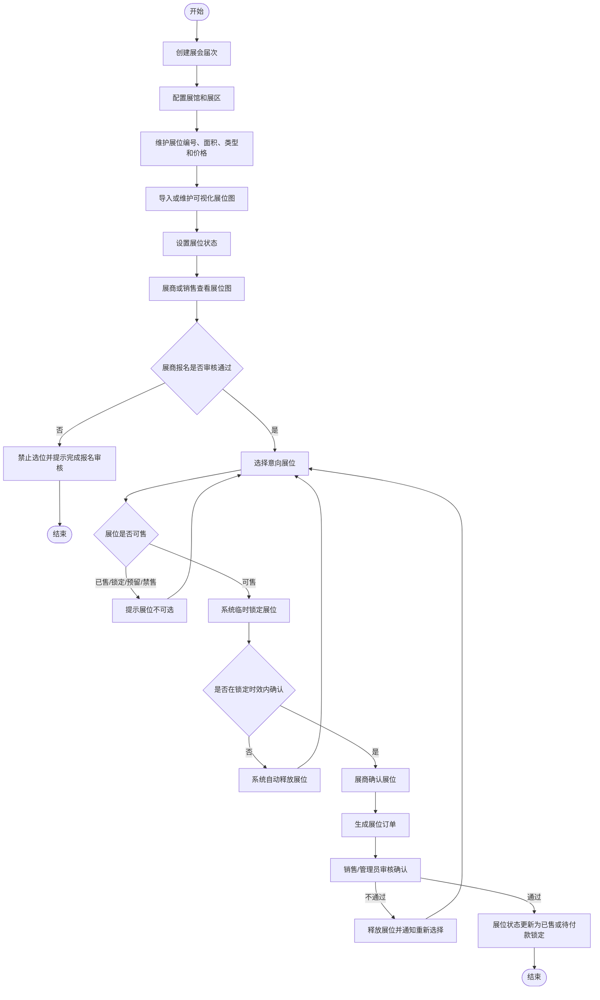
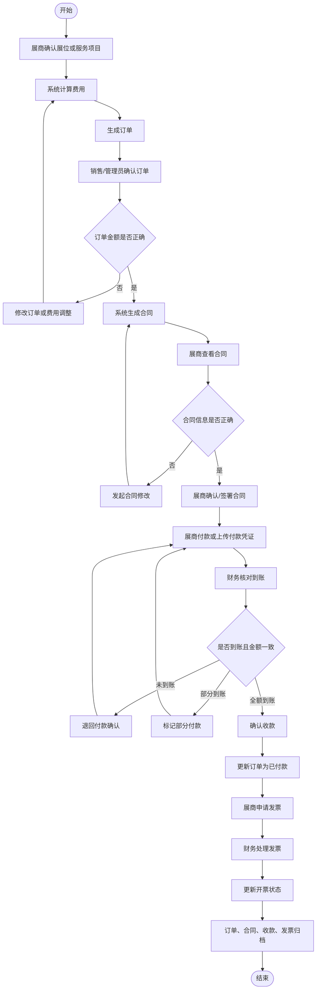
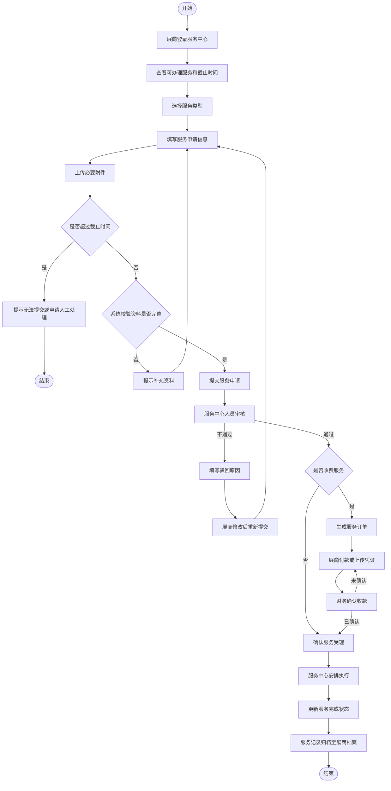
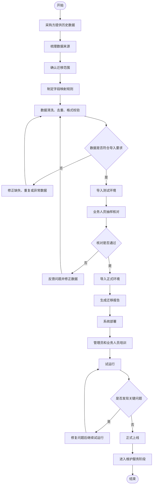
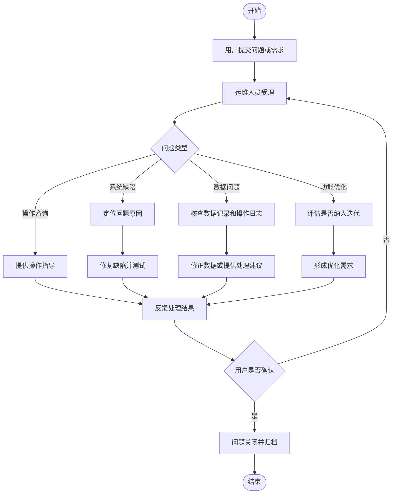

# 中国国际体育用品博览会展商系统业务流程梳理

## 1. 项目定位

中国国际体育用品博览会展商系统不是单一的展商报名网站，而是一套面向大型展会运营的展商全生命周期管理系统。

系统需要覆盖展商从报名、审核、选展位、生成订单、签署合同、付款、办理参展服务，到展会结束后数据归档的完整业务闭环。

核心业务主线为：

```text
展商报名
-> 资质审核
-> 展位选择/分配
-> 订单生成
-> 合同生成与签署
-> 财务收款与发票
-> 展商服务办理
-> 参展资料归档
-> 历史数据沉淀
```

## 2. 主要参与角色

| 角色 | 主要职责 |
| --- | --- |
| 展商 | 注册登录、提交报名资料、选择展位、确认订单合同、付款、办理参展服务 |
| 主办方管理员 | 展会配置、展商审核、展位确认、合同订单管理、数据统计 |
| 招商销售人员 | 跟进展商、协助选位、锁定展位、确认订单、维护客户关系 |
| 展位规划人员 | 管理展馆、展区、展位图、展位编号、展位面积、价格和状态 |
| 财务人员 | 核对收款、登记到账、处理发票、管理退款或费用调整 |
| 服务中心人员 | 审核并处理展商提交的证件、楣板、用电、家具、搭建等服务申请 |
| 系统管理员 | 用户、角色、权限、参数、日志、数据备份和系统维护 |

## 3. 整体业务闭环

### 3.1 流程说明

整体业务从展商报名开始，经过主办方审核后进入展位销售流程。展位确认后生成订单和合同，展商完成付款，财务确认收款。随后展商进入服务中心办理参展相关事项，最终形成展商、展位、订单、合同、财务和服务数据的统一归档。

### 3.2 Mermaid 流程图



## 4. 展商报名与审核流程

### 4.1 业务目标

让展商在线完成注册、企业资料维护、参展报名和资质材料提交，主办方在线完成审核、驳回、补充资料和通过处理。

### 4.2 关键业务规则

- 展商必须完成注册或登录后才能提交报名。
- 报名信息应包含企业信息、联系人、参展品类、意向面积等。
- 资质材料可包括营业执照、品牌授权、产品认证、历史参展资料等。
- 报名资料不完整时，系统应阻止提交或提示补充。
- 审核不通过时，必须记录驳回原因。
- 审核通过后，展商才可进入展位选择、展位确认或招商跟进流程。

### 4.3 Mermaid 流程图



## 5. 展位规划与展位图销售流程

### 5.1 业务目标

主办方通过系统维护展馆、展区、展位、价格和展位状态，展商或招商销售基于展位图完成选位、锁位、确认和销售，避免重复销售。

### 5.2 关键业务规则

- 展位需要具备编号、面积、类型、所属展馆、所属展区、价格和状态。
- 展位状态至少包括可售、锁定、已售、预留、禁售。
- 展商只有在报名审核通过后才能进行选位。
- 展位被选择后应进入临时锁定状态。
- 锁定应有时效，超时未确认自动释放。
- 同一展位不能被多个展商同时购买。
- 展位变更、换位、释放应保留操作记录。

### 5.3 Mermaid 流程图



## 6. 订单、合同与财务收款流程

### 6.1 业务目标

展商确认展位或服务项目后，系统自动生成订单；订单确认后生成合同；展商签署合同并付款；财务完成到账确认、发票处理和归档。

### 6.2 关键业务规则

- 订单金额应根据展位面积、展位单价、服务项目、优惠或调整项计算。
- 合同应与订单、展商、展位信息关联。
- 合同信息有误时，应允许重新生成或发起变更。
- 财务确认到账后，订单状态才能更新为已付款。
- 支持部分付款、未付款、已付款、退款、作废等状态。
- 发票申请应与订单和收款记录关联。

### 6.3 Mermaid 流程图



## 7. 展商服务中心流程

### 7.1 服务中心定义

展商服务中心是面向参展企业的线上服务办理模块，用于集中承载参展前、中、后所需的证件、楣板、搭建、用电、网络、广告、家具、物流等服务申请、审核、收费、执行和归档流程。

它不是普通客服窗口，而是展商参展前办理各种配套事项的线上办事大厅。

### 7.2 常见服务事项

| 服务类型 | 典型内容 |
| --- | --- |
| 证件服务 | 展商证、施工证、车辆证、布撤展证 |
| 楣板信息 | 标准展位公司名称、英文名称、展位名称 |
| 用电网络 | 额外用电、网络、水、气、压缩空气 |
| 家具租赁 | 桌椅、展柜、洽谈桌、电视、灯具 |
| 广告服务 | 会刊广告、现场广告、LED 屏、资料袋广告 |
| 特装搭建 | 施工图、效果图、搭建公司资质、安全承诺书 |
| 物流运输 | 展品运输、进馆时间、货车信息、物流服务 |
| 费用服务 | 服务订单、付款凭证、发票申请 |

### 7.3 Mermaid 流程图



## 8. 数据管理与数据迁移流程

### 8.1 业务目标

将采购方历史展商、展位、订单、合同、财务、服务申请等数据迁移到新系统，并完成数据清洗、字段映射、测试导入、业务核对和正式上线。

### 8.2 关键业务规则

- 迁移前应明确数据来源，包括旧系统数据库、Excel、历史文件等。
- 需要确认迁移范围，避免遗漏核心业务数据。
- 数据导入前应完成清洗、去重、格式校验和字段映射。
- 测试环境导入后，应由业务人员抽样核对。
- 核对不通过的数据应退回修正。
- 正式迁移后应提供迁移报告。

### 8.3 Mermaid 流程图



## 9. 系统维护服务流程

### 9.1 业务目标

保障系统上线后稳定运行，支持问题响应、缺陷修复、数据备份、权限调整、功能优化和展会周期内的运营支持。

### 9.2 Mermaid 流程图



## 10. 核心业务关系

系统中的核心业务对象关系如下：

```text
展会
  -> 展馆
    -> 展区
      -> 展位

展商
  -> 报名申请
  -> 资质材料
  -> 展位订单
  -> 合同
  -> 收款记录
  -> 发票申请
  -> 服务申请

订单
  -> 展位费用
  -> 服务费用
  -> 合同
  -> 收款记录
  -> 发票记录

服务申请
  -> 审核记录
  -> 服务订单
  -> 付款记录
  -> 执行记录
```

## 11. 一期建议优先实现的业务流程

结合 50 万元预算和公告采购范围，建议一期优先覆盖以下流程：

1. 展商注册、报名、审核流程。
2. 展馆、展区、展位和展位图维护流程。
3. 展位选择、锁定、确认和销售流程。
4. 订单生成、确认、调整流程。
5. 合同生成、确认、归档流程。
6. 财务收款、付款凭证、发票状态管理流程。
7. 展商服务中心基础申请与审核流程。
8. 历史数据迁移、部署、培训和维护流程。

## 12. 业务难点提示

### 12.1 展位图销售是系统难点

展位图销售涉及展位坐标、展位状态、并发锁位、价格计算和展位调整。若要支持展商像选座一样自主选展位，需要重点设计锁位机制和防重复销售机制。

### 12.2 订单、合同、财务必须保持一致

展位调整、面积变更、价格优惠、服务增购都会影响订单金额，进而影响合同和财务收款。系统应记录每次变更，并保证订单、合同、收款之间的数据可追溯。

### 12.3 数据迁移会影响上线周期

历史数据可能存在字段缺失、格式不一致、重复展商、历史订单不完整等问题。迁移前必须进行数据清洗和抽样核对。

## 13. 总结

中国国际体育用品博览会展商系统的核心不是单点功能，而是展商参展全流程数字化。

系统应围绕以下主线建设：

```text
展商准入
-> 展位资源销售
-> 订单合同财务闭环
-> 参展服务办理
-> 数据归档复用
```

这套流程既能支撑投标方案中的业务理解，也可以进一步扩展为产品需求文档、详细设计说明书或系统原型设计依据。
